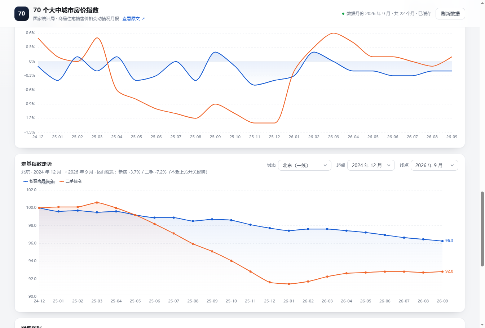

# 70 城房价指数看板

一个零依赖的国家统计局数据看板，聚焦 **70 个大中城市商品住宅销售价格指数**。


## 数据来源

| 项目 | 说明 |
| --- | --- |
| 原始出处 | 国家统计局 · 数据发布《XX 年 X 月份 70 个大中城市商品住宅销售价格变动情况》 |
| 页面地址 | <https://www.stats.gov.cn/sj/zxfb/> |
| 更新频率 | 每月中旬发布上月数据 |
| 可回溯区间 | **2011 年 1 月起**，共 189 个月（70 城数据自 2011-01 开始按月发布，更早的月度分城市数据官方未公开） |
| 本地数据集 | `data/periods.json`（1.4 MB / 189 个月），随项目分发，启动时直接读它 |
| 指标口径 | 指数以「上月 = 100」「上年同月 = 100」为基准，页面统一换算成涨跌幅（指数 − 100） |

### 为什么不直接在前端调接口

- 统计局新版数据门户（`data.stats.gov.cn`）受 WAF 保护，直接调用会返回 `403 UrlACL`；
- 即使能调通，浏览器也会有跨域限制，无法直接 `fetch`。

因此本项目用 **Node 本地服务做代理**：服务端定位每月月报 → 解析正文里内嵌的 70 城表格 → 转成 JSON 缓存到 `.cache/`，前端只读本地接口。这样既绕开了跨域，也不会每次都去请求统计局站点。

### 历史月报是怎么找回来的

「数据发布」列表页（`/sj/zxfb/`）只静态生成到 `index_66.html`，最深只能翻到 2021 年 11 月，看不到更早的月报。而 2011–2022 年的文章其实都还在，只是被批量迁移进了 `/sj/zxfb/202302/`、`/sj/zxfb/202303/` 这类归档目录，列表页里不再有入口。

所以索引改走 **统计局站内搜索**：`POST https://api.so-gov.cn/query/s`，表单体 `{ siteCode: 'bm36000002', qt: '70个大中城市商品住宅销售价格变动情况', page, pageSize }`（`siteCode` 取自页面 `<meta name="SiteIDCode">`）。搜索能命中 2011 年以来的全部月报，再对命中结果按年月去重，对少数漏搜的月份做精确补搜。列表页扫描保留为兜底分支。

索引结果缓存 6 小时，见 `.cache/index.json`。

### 数据一次性固化在本项目里

统计局一个月才更新一次，没必要每次打开都去翻网络。抓到的全部月份会被固化成 **`data/periods.json`**（189 个月，约 1.4 MB）：

- 启动时直接读它，**零网络请求**，打开即用；
- 顶部的时间范围只影响展示，同样不触发下载；
- 需要更新数据时才点右上角「刷新数据」—— 会重新检索引（前两页，几秒）、只抓缺失的月份，完成后自动覆盖 `data/periods.json`。

`.cache/` 是抓取过程中的中间产物（解析结果 + 月报原文），可以随时删；`data/` 是成果，建议一起提交到仓库。

### 月份戳：每月最多自动核对一次

`data/periods.json` 里有两个字段记录「上次什么时候核对的」：

```json
{
  "checkedMonth": "2026-11",
  "checkedAt": "2026-11-09T13:05:19.380Z"
}
```

打开页面（或服务启动）时的规则：

| 月份戳 | 行为 |
| --- | --- |
| `checkedMonth` == 当前月份 | 本月已核对过，直接用本地数据，**不联网** |
| `checkedMonth` != 当前月份（跨月了） | 后台静默核对一次，完成后把戳改成当前月份 |

核对只翻搜索结果的前两页（新发布的月报一定在最前面），抓到新月份才去下载该月原文，所以通常**一两秒**就完。整个过程在后台跑，页面先用旧数据渲染，不会卡在加载页；核对失败也不弹错，10 分钟后或下个月再试。

因此只要每月打开一次页面，数据就会自动跟上最新一期；不想等也可以随时点「刷新数据」手动触发。

## 快速开始

**Windows：直接双击 `start.bat`** —— 会自动启动服务并打开浏览器；如果服务已在运行，则只打开页面。关闭窗口即停止服务。

命令行等价写法：

```bash
node server.js
```

然后打开 <http://127.0.0.1:5173>。

> 必须通过这个本地服务访问，直接双击 `index.html` 是不行的：`file://` 下 `fetch('/api/nbs70')` 会被浏览器拦下，拿不到数据。

- 需要 Node >= 20，**不需要 `npm install`**（ECharts 已内置在 `public/vendor/`）。
- 启动即读 `data/periods.json`，**不联网**，秒开；如果月份戳不是本月，会在后台自动核对一次（见上文）。
- 顶栏右侧的「时间范围」只做本地过滤（近 1 / 2 / 3 / 5 / 10 年、全部、自定义区间），**默认「近 5 年」**，选完后下方所有与时间相关的图表都跟着变；选择记在 `localStorage`（键 `nbs70.range.v2`）里，刷新后保留。
- 想立即拿最新一期数据，点「刷新数据」：翻搜索前两页 + 重抓最近 3 个月（统计局可能修订），约 5-10 秒。
- `node_modules/` 里是当初把 ECharts 拷贝到 `public/vendor/` 时留下的临时目录，**可以整个删掉**，不影响运行。

换端口：`PORT=8080 node server.js`。Windows 下用 `start.bat` 时可以 `set NBS_PORT=5180` 后再双击。

## 打包给别人（对方不装 Node）

`node server.js` 需要 Node 运行时。要发给装不了 Node 的人，用**便携包**：把 `node.exe` 和项目一起打进去，对方解压双击 `start.bat` 就行，**不需要安装任何东西**。

```powershell
powershell -ExecutionPolicy Bypass -File packaging\build.ps1
```

产物：

```
release/70城房价看板/                                    解压后双击 start.bat（69.8 MB）
release/70city-housing-price-index-v1.1.0-win10-win11.zip  对外发送（27.3 MB）
```

包内是 `node.exe`（v20.12.2，官方签名二进制）、`server.js`、`lib/`、`public/`、`data/periods.json`、`docs/`、`start.bat`、`使用说明.txt`；不含 `.cache/`、`node_modules/`。功能与源码版完全一致：跨月自动核对、「刷新数据」都照常可用。

- 便携版的 `start.bat` 和 `使用说明.txt` 放在 `packaging/` 里跟代码一起维护，`build.ps1` 打包时会拷过去。
- 想换 node.exe：`packaging\build.ps1 -NodeExe 'D:\soft\nvm\v20.12.2\node.exe'`。
- 内置的是 Node 20，因此**只支持 Windows 10 / 11**；Windows 7 / 8 不再支持（Node 18 起已放弃这些系统，最后能跑 Win7 的是 Node 16）。
- `release/` 已加进 `.gitignore`，几十 MB 的 `node.exe` 不进仓库。
- zip 直接用纯 ASCII 名（`70city-housing-price-index-v<版本>-<系统>.zip`），因为 GitHub Release 附件名不接受中文、会被静默删掉；zip 内部顶层目录仍是中文的 `70城房价看板`。
- 换支持的 Windows 范围时改 `-SysTag`（默认 `win10-win11`）：`build.ps1 -SysTag 'win7-win11'`。

> 为什么不用 pkg 打成单个 exe：体积差不多（~45 MB），但自解压 exe 常被杀软误报；更麻烦的是包内 `data/` 会变成只读的虚拟文件系统，「刷新数据」写不进去，得额外改路径。便携 `node.exe` 是官方签名的，零误报、行为完全一致。

## 目录结构

```
server.js              本地 HTTP 服务：静态资源 + /api/nbs70
start.bat              Windows 一键启动（双击即可）
lib/nbs70.js           采集与解析：站内搜索建索引 → 月报正文表格解析 → 磁盘缓存
public/index.html      页面结构
public/styles.css      样式
public/app.js          前端逻辑与 ECharts 图表
public/vendor/         ECharts 5（已内置）
docs/                  页面截图
data/periods.json      本地数据集（189 个月，随项目分发）
packaging/             便携包的 start.bat / 使用说明.txt（build.ps1 只在本地，不入库）
release/               打包产物，不入库（见上文「打包给别人」）
.cache/                抓取中间产物：解析结果 + 月报原文（自动生成，可安全删除）
```

## 接口

`GET /api/nbs70?months=24&force=0`

`months` 取值 1–200（200 = 全部历史）。默认走本地数据集；只有当月份戳不是当前月时，才会在后台做一次静默核对。带 `force=1` 立即核对并重抓最近 3 个月。

```jsonc
{
  "status": "ready",        // loading | ready | error
  "phase": null,            // index（正在建历史索引）| fetch（正在抓月报）
  "loaded": 22,             // 已解析月份数（loading 时用于进度条）
  "total": 24,
  "dataset": {              // 数据来源：本地数据集存在时体现在这里
    "generatedAt": "2026-11-09",
    "checkedMonth": "2026-11",   // 月份戳：上次向统计局核对的年月
    "checkedAt": "2026-11-09T13:05:19.380Z",
    "firstMonth": "2011-01",
    "lastMonth": "2026-09",
    "count": 189
  },
  "autoCheck": false,       // true = 后台正在做“跨月自动核对”，前端文案不同
  "periods": [              // 按月份升序
    {
      "month": "2026-09",
      "publishedAt": "2026-10-19",
      "title": "2026年9月份70个大中城市商品住宅销售价格变动情况",
      "url": "https://www.stats.gov.cn/...",
      "new": {              // 新建商品住宅
        "北京": { "mom": 99.8, "yoy": 97.3, "ytd": 97.7, "tier": 1 }
      },
      "second": { /* 二手住宅，结构同上 */ }
    }
  ]
}
```

- `mom` 环比、`yoy` 同比，均为指数值（100 = 持平）。
- 第 4 列的口径年年在变：**2018 年及以前**统计局给的是「定基指数」（以 2010 年或上轮基期为 100），存在 `fix` 字段；**2019 年起**改成「1—N 月平均」，存在 `ytd` 字段。两者不可直接比较，前端未使用。
- `tier`：1 一线 / 2 二线 / 3 三线，按国家统计局 70 城分类口径。
- `force=1` 立即核对一次（翻搜索前两页 + 重抓最近 3 个月），完成后会重写 `data/periods.json` 并把月份戳改成当前月份。

## 图表说明

| 模块 | 内容 |
| --- | --- |
| KPI 卡片 | 最新月份、新房 / 二手的环比上涨城市数、同比下跌城市数 |
| 指数走势 | 多城市对比折线，城市可自由勾选，支持按档位一键选全 |
| 涨跌城市数 | 每月 70 城中上涨 / 持平 / 下跌的堆积柱 |
| 城市排行 | 最新月份 70 城横截面排序，红涨绿跌，右侧滑块可滚动 |
| 城市 × 月份热力图 | 70 城 × N 月的涨跌幅矩阵，默认从一线城市开始（列数上限 60，取最近 60 个月） |
| 单城详情 | 选定城市新房 vs 二手房的走势对比 |
| 定基指数走势 | 自选起点/终点月份，以起点月为 100，按环比逐月累乘，对比新房与二手房的区间累计涨跌 |
| 明细数据 | 最新月份全量数据表，点表头排序、点行切换单城详情 |

所有图表都是**单行通栏**，不并排：数据密度高，两列并排会把坐标轴和柱子压得太细。

顶部两个开关（房屋类型 / 对比口径）会同步作用于除 KPI 和定基指数外的所有图表。

顶栏的**时间范围**是全局过滤器：它不删数据，只是把展示窗口从 189 个月里切出一段（`state.view`），走势、城市数、排行、热力图、单城详情、明细表全部跟着变；定基指数那块有自己独立的起止月份下拉（默认跟随当前区间），标注了「不受上方开关影响」。

### 定基指数的算法

```
index[起点] = 100
index[t]  = index[t-1] × 环比指数[t] / 100
```

注意起点月份自身的环比**不参与**计算（它已经定义为 100），区间涨跌 = `index[终点] − 100`。
例如北京新房 2025-10 → 2026-09 累乘得到 97.62，即区间下跌 2.4%。



## 备注

- **这不是成交均价**。价格指数反映的是价格变动的相对幅度，不含绝对价格水平。
- 单月解析失败不会影响整体，会跳过该月并在日志里提示；如需重试，加 `?force=1` 或删掉 `.cache/`。
- `.cache/raw/` 存放月报原文（gzip 压缩，189 篇共约 8 MB）。解析器改了之后，有原文的月份可以离线重解析，不必重新下载；需要全量回填原文时 `npm run data:raw`。
- 解析要兼容三代表结构：2011–2016 的表头写作「新建住宅价格指数 / 二手住宅价格指数」（无「销售」二字），2016–2022 为「商品住宅」，2023 起回归「商品住宅销售价格」；此外 2012-06 北京的城市名带脚注星号「北京*」，均已做兼容。
- 若统计局改版导致解析失败，主要调整 `lib/nbs70.js` 里的 `buildArticleIndex` / `searchArticleIndex`（索引）、`tableKind`（表类型识别）与 `parseArticle`（正文表格）。解析器改动后请递增 `PARSER_VERSION`，旧缓存会自动失效。
- 页面样式中的配色遵循国内习惯：**红涨绿跌**。

## 反馈与联系

- **问题 / 建议**：优先到 [Issues](https://github.com/cwq503448212/70city-housing-price-index/issues) 提，便于追踪与公开讨论
- **邮箱**：503448212@qq.com（仅用于本项目相关沟通）
