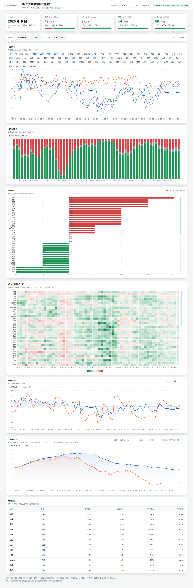
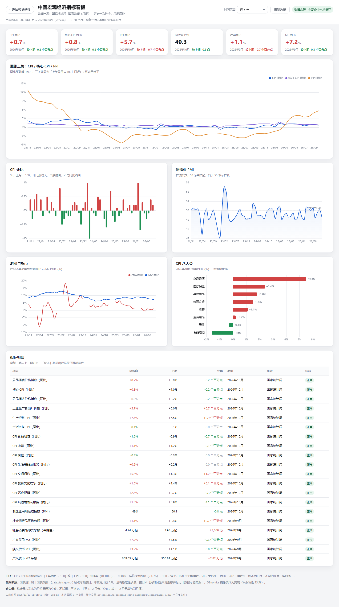
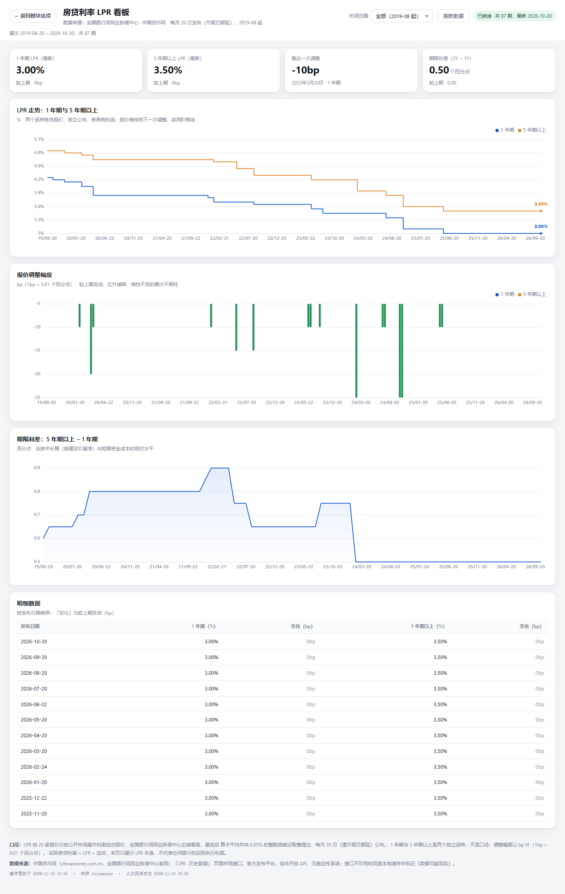
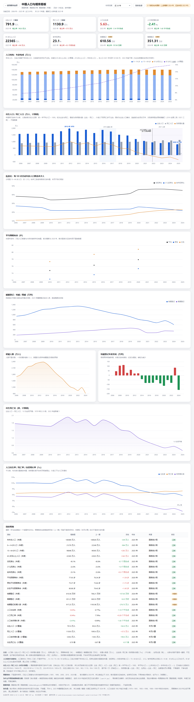
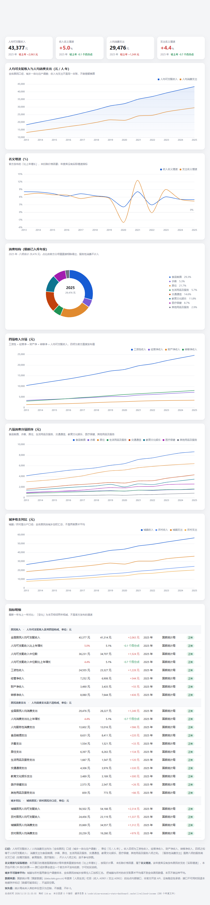
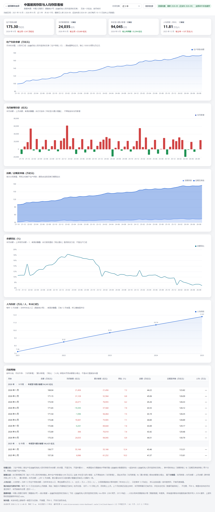
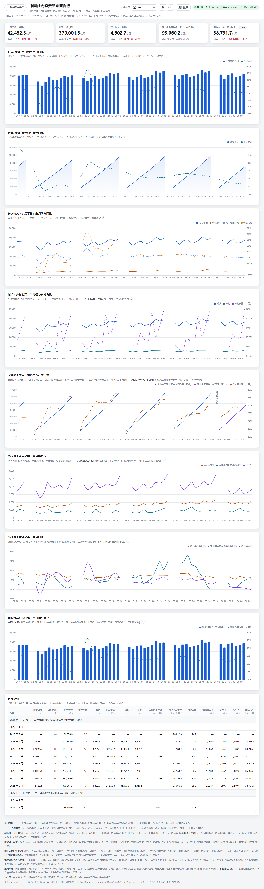
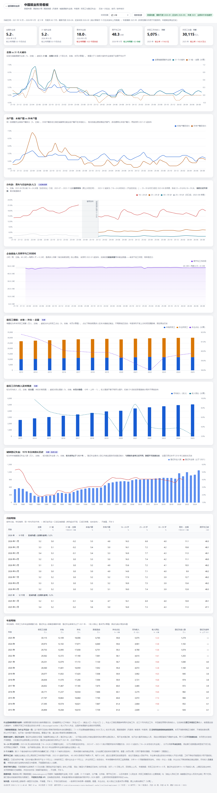
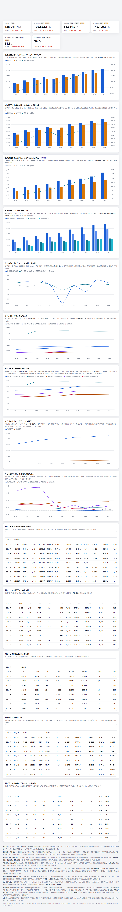

# 中国经济统计数据看板

一个零依赖的本地看板：**九个模块、一个进程、一份本地缓存**。数据全部由服务端代取，首次打开一次拉全历史，之后每次打开只核对应发布期别——有新一期就补进去，没发布就直接读缓存。

| 模块 | 地址 | 内容 | 频次 · 起点 |
| --- | --- | --- | --- |
| **70 个大中城市房价指数** | `/housing/` | 新房 / 二手住宅环比、同比，城市排行、涨跌城市数、热力图、定基指数 | 月度 · 2011-01 |
| **宏观经济指标** | `/macro/` | CPI / 核心 CPI / PPI / 八大类 / PMI / 社零 / M1·M2，共 20 个指标 | 月度 · 2021-01 |
| **房贷利率 LPR** | `/lpr/` | 1 年期 / 5 年期以上报价、每次调整幅度、期限利差、明细 | 月度 · 2019-08 |
| **人口与婚育** | `/livelihood/` | 年龄结构与抚养比、老龄化、平均预期寿命，结婚 / 离婚 / 初婚，出生率 / 死亡率 / 自然增长率（人口分段 1982 起、预期寿命止 2020） | 年度 · 1978 |
| **人均收入与支出** | `/livelihood/income/` | 可支配收入（名义增速、中位数）、四项收入、消费支出、八项消费、城乡对比 | 年度 · 2013 |
| **居民存款与人均存款** | `/livelihood/deposit/` | 住户存款余额、当月新增、年初至今累计、活期 / 定期结构、余额同比、年末人均存款 | 月度 · 2015 |
| **社会消费品零售** | `/livelihood/retail/` | 社零当月 / 累计 / 同比、餐饮 / 商品、城镇 / 乡村、网上零售、剔除汽车、限额以上品类 | 月度 · 2015-02 |
| **就业形势** | `/livelihood/employment/` | 全国与 31 城调查失业率、分户籍 / 分年龄、周平均工时、农民工、城镇登记失业 | 月度 2018-01 + 年度 1978 |
| **养老医保** | `/livelihood/security/` | 五险基金收支结余、职工 / 城乡居民养老、基本医保、失业工伤生育、人均养老金、可支付月数、参保率 | 年度 · 1990 |

打开根地址 `/` 是模块选择页，点进去分别进入九个子页面；每个子页面右上角「← 返回模块选择」可以切回来。


## 快速开始

**Windows 直接双击 `start.bat`**：自动启动服务并打开浏览器，服务已在跑就只开页面，关闭窗口即停止。命令行等价写法：

```bash
node server.js
```

然后打开 <http://127.0.0.1:5173>。

- 需要 Node >= 20，**不需要 `npm install`**（ECharts 已内置在 `public/vendor/`，九个看板共用一份）。
- 必须经这个本地服务访问：直接双击 `public/**/index.html` 不行——`file://` 下 `fetch('/api/...')` 会被浏览器拦下；统计局 / 央行站点还有 WAF，浏览器直连会 403，数据只能由服务端代取。
- 换端口：`$env:PORT=8080; node server.js`；用 `start.bat` 时可以先 `set DASH_PORT=5180`（旧的 `NBS_PORT` 仍兼容）。

## 目录结构

```
server.js                    本地 HTTP 服务：静态托管 + 路由分发
start.bat / build.bat        Windows 一键启动 / 一键打包（转发给 packaging/build.ps1）
probe.js                     指标编码探测（月度库 / 年度库）+ 官方与 DBnomics 交叉校验
AGENTS.md                    各看板共用的开发规范

lib/housing/nbs70.js         房价：站内搜索建索引 → 月报正文表格解析 → 数据集读写
lib/macro/                   宏观：config / cache（policy 唯一回源判定 + store）/ services / sources（nbs + dbnomics）
lib/lpr/                     LPR：config / policy / source（中国货币网）/ store（单文件全量）/ api
lib/livelihood/              人口与婚育：config / policy / source（年度库）/ store / service / queue / api
lib/livelihood/income/       人均收支：独立的 config / store / service / api，取数复用父目录
lib/livelihood/deposit/      存款：独立取数（央行信贷收支表 htm 解析），限流复用父目录 queue
lib/livelihood/retail/       社零：独立取数（国家数据月度库），限流复用父目录 queue
lib/livelihood/employment/   就业：独立取数（月度库 + 年度库双频次），限流复用父目录 queue
lib/livelihood/security/     养老医保：取数复用父目录 source，限流复用父目录 queue

config/*.json                各模块的唯一事实来源：indicators / livelihood / income / deposit / retail / employment / security
public/                      index.html + home.css（入口）；housing、macro、lpr、livelihood/{income,deposit,retail,employment,security}；vendor/echarts.min.js
data/periods.json            房价数据集（189 个月，随仓库分发）
docs/                        页面截图
packaging/                   便携包的 build.ps1 / start.bat / 使用说明.txt
.cache/                      运行时缓存（macro / lpr / livelihood* / raw），可随时删除
```

## 九个看板共用的机制

- **服务端代取**：前端只请求 `/api/...`，不直连任何上游域名。
- **缓存优先**：有本地数据就用本地数据，只在「缺数据 / 过了发布日 / 用户点刷新」时回源。缓存都是可删的 JSON，删掉只会让下次重新拉全。
- **首次拉全、之后只核对**：第一次打开把历史一次性拉全写盘再渲染；之后每次只核对应发布期别，有新一期补进去，没发布直接读缓存。
- **首屏不等上游**：区间里有缓存就先出图，回源放后台；前端只消费 `stale` / `refreshing` 字段，不自己算日期。
- **落后太多就等补齐**：最新缓存比应发布期别落后 3 期以上（比如包放很久才打开）时同步补齐再渲染，不先摆过期图。
- **失败回退缓存**：上游挂了或返回非预期内容 → 回退本地数据并标 `stale: true`，不抛 500、不返回空数组。
- **缺失就是缺失**：缺值一律 `null`，不插值、不补 0、不自行加权合成；一条序列只来自单一数据源。
- **限流三层**：所有对外请求串行 + 全局最小间隔（统计局 1200 ms、DBnomics 500 ms）+ 同一指标 60 秒冷却；两次回源尝试至少隔 10 分钟（`_meta.json` 的 `lastAttempt` 落盘，重启仍生效）。
- **错误码**：客户端传了不存在的指标 / 路径 → 404；只有配置或代码错误才 500。
- **口径必须标注**：同比 / 环比 / 定基不混画同一条线；指数存原值、展示成涨跌幅并注明「100 = 持平」；计算值一律在图注里声明。
- **前端约定**：原生 HTML/CSS/JS + 本地 ECharts，禁用 CDN 与构建工具；图表单行通栏，不两列并排；红涨绿跌；筛选条件存 `localStorage`，改默认值必须同时升级键名。

### 接口一览

除房价（`/api/nbs70` 单端点）与 LPR（只有 `overview` / `health`）外，各模块统一提供 `overview`（整页一次取全量）/ `indicators` / `series/:id` / `refresh/:id` / `health` 五个端点：

| 前缀 | 查询参数 |
| --- | --- |
| `/api/health` | 健康检查，九个看板共用（含各模块缓存概况） |
| `/api/nbs70` | `months=1..200`（200 = 全部历史）、`force=1` |
| `/api/macro/` | `range=12\|36\|60\|120\|all`、`from=YYYY-MM&to=YYYY-MM`、`force=1` |
| `/api/lpr/` | 只有 `overview` 与 `health`，`force=1` |
| `/api/livelihood/` | `range=10\|20\|30\|all`、`from=YYYY&to=YYYY`、`force=1` |
| `/api/livelihood/income-expenditure` | `range=5\|10\|all`、`from=YYYY&to=YYYY`、`force=1` |
| `/api/livelihood/reserve-deposit` | `range=2\|5\|all`、`from=YYYY-MM&to=YYYY-MM`、`force=1` |
| `/api/livelihood/retail` | `range=2\|5\|all`、`from=YYYY-MM&to=YYYY-MM`、`force=1` |
| `/api/livelihood/employment` | `range=2\|5\|all`（只作用于月度指标）、`from=YYYY-MM&to=YYYY-MM`、`force=1` |
| `/api/livelihood/security` | `range=10\|20\|all`、`from=YYYY&to=YYYY`、`force=1` |

`from` / `to` 优先于 `range`。各模块的指标 id 全部写在对应的 `config/*.json` 里，可直接核对。

---

# 模块一：70 个大中城市房价指数

**数据来源**：国家统计局《XX 年 X 月份 70 个大中城市商品住宅销售价格变动情况》月报（每月中旬发上月，<https://www.stats.gov.cn/sj/zxfb/>）。可回溯 **2011 年 1 月起共 189 个月**，已固化为 `data/periods.json`（约 1.4 MB），启动时直接读，**零网络请求**。

- **历史月报怎么找回来**：列表页只静态生成到 `index_66.html`（最深 2021-11），更早的文章被迁进 `/sj/zxfb/2023xx/` 归档目录、列表页没有入口。所以索引走**统计局站内搜索** `POST https://api.so-gov.cn/query/s`（`siteCode: bm36000002`），命中后按年月去重、对漏搜月份精确补搜，列表页扫描保留为兜底；索引缓存 6 小时（`.cache/index.json`）。
- **月份戳**：`checkedMonth` 是当前月就直接读本地数据、不联网；跨月则后台静默核对一次（只翻搜索结果前两页），抓到新月份才下载该月原文。核对失败不弹错，10 分钟后或下个月再试。「刷新数据」= `force=1`，重抓最近 3 个月。
- **解析兼容**：三代「新建住宅 / 商品住宅」表头都兼容，2012-06 的「北京*」脚注星号也已处理；单月失败只跳过该月。`.cache/raw/` 存 189 篇月报原文（gzip 约 8 MB），改了解析器可以离线重解析；改解析逻辑后要递增 `PARSER_VERSION`，旧缓存自动失效。
- **口径**：`mom` 环比、`yoy` 同比都是指数值（100 = 持平）。第 4 列年年在变——**2018 年及以前**是定基指数（存 `fix`），**2019 年起**是「1—N 月平均」（存 `ytd`），两者不可比，前端未使用。`tier` 1/2/3 线。
- **定基指数**：起点 = 100，之后每月 × 环比指数 / 100（起点月自身的环比不参与），区间涨跌 = 终点 − 100。
- **图表**：KPI 卡片、多城市指数走势、涨跌城市数、城市排行、城市 × 月份热力图（最近 60 个月）、单城详情、定基指数、明细表。顶部时间范围默认近 5 年（`nbs70.range.v2`），定基指数有独立的起止月份。



---

# 模块二：宏观经济指标

国家统计局月度宏观数据：**CPI / 核心 CPI / PPI / 八大类 / PMI / 社零 / M1·M2，共 20 个指标**，一个时间范围下拉框联动整页（默认近 5 年）。

**主源**是「国家数据」新版站点内部接口：

```
GET  …/dg/website/publicrelease/web/external/new/queryIndexTreeAsync?pid=&code=1   // code=1 月度库
GET  …/new/queryIndicatorsByCid?cid=<栏目id>&dt=&name=
POST …/stream/esData    body = { cid, indicatorIds, das:[{全国,000000000000}], dts:['202101MM-202612MM'], rootId }
```

> ⚠️ **这是统计局网站前端自己用的内部接口，不是官方开放 API**，没有稳定性承诺。老版 EasyQuery（`easyquery.htm?m=QueryData`）已被站点 WAF 全站拦截（403 / `reason: UrlACL`），不要再回退到那条路由。

**兜底**是 DBnomics 开放 API，只在主源失败时使用；它镜像的 NBS 序列只保留最近 13 期且滞后，所以兜底数据一定标 `stale`。

- **编码不靠猜**：每个栏目 id、指标 id 都由 `probe.js` 探测出来，并与 DBnomics 同期刊交叉校验（容差 0.1）。流程是 `tree` → `indicators` → `data` 看量级 → 写进 `config/indicators.json` → `check` 通过。
- **栏目按年份分段**（`2026-`、`2021-2025`、`2016-2020`、`-2015`），一个指标可能要多个 `segments` 拼接；历史起点 2021-01（现行八大类口径）；2026 年起「食品烟酒类」调整为「食品烟酒及在外餐饮类」，配置里已分段并在页面标注。
- **缓存**：键 = 指标 id + 统计月份，落盘 `.cache/macro/<指标id>/<YYYY-MM>.json`，存**原始值**（指数存 101.3 不存 1.3），换算成涨跌幅在接口 / 前端做。首次打开一次拉全（约 8 次请求、半分钟）；之后只核对当期缺口；某个指标落后 3 期以上时同步补齐再渲染。
- **发布日**写在配置里：CPI / PPI = 每月 9 日发上月，社零 / M2 = 每月 15 日，PMI = 当月月末；本身不发布的月份用 `exemptMonths` 排除（社零 1、2 月合并公布），不计入「缺数据」。判定逻辑集中在 `lib/macro/cache/policy.js`。
- **口径**：同比 / 环比 / 定基三种不混画；缺失用 `null`；分项不自行加权合成总指数；一条序列只来自单一数据源。
- 缓存目录可用 `MACRO_DATA_DIR` 指到任意可写目录。



---

# 模块三：房贷利率 LPR

**1 年期与 5 年期以上两个品种**，自 2019-08-20 首次发布起的全历史（约 90 期）。数据来自**中国货币网**（全国银行间同业拆借中心官网，即 LPR 官方发布平台）：

```
POST https://www.chinamoney.com.cn/ags/ms/cm-u-bk-currency/LprHis?lang=CN&strStartDate=…&strEndDate=…
```

- 站点有 WAF：必须带浏览器 UA 与 Referer，HTTP 200 且 `head.rep_code === '200'` 才算成功；期限字段名以 `data.baseCurveCfgList` 为准（当前 `['1Y','5Y']`），防站点改列名。
- ⚠️ **上游限制：一次查询跨度超过一年就返回空 `records`**（「只提供一年历史数据查询及下载」），所以按自然年分段请求（约 8 段）再按日期去重合并，段间留 400 ms；本项目永远整段拉全，不做增量。
- **缓存**：`.cache/lpr/lpr.json`（全量单文件）+ `_meta.json`（回源时间戳）；目录可用 `LPR_DATA_DIR` 覆盖。
- **拉取**：首次打开同步分段拉全（几秒）；之后每月 20 日判定，缓存到了本月应发布日就直接用，否则后台核对一次、先展示缓存（前端 3 秒后重取，最多 5 次）。节假日顺延本地算不出，仍按 20 日判定，顺延后再打开会再核对一次（10 分钟冷却内不重复）。
- **口径**：两品种独立画线；`3.5` 存原值、展示为 `3.50%`；调整幅度换算成 bp（1bp = 0.01 个百分点）；页面只展示 LPR 本身，实际房贷利率 = LPR + 加点，不代表任何银行执行利率。



---

# 模块四：人口与婚育

**16 个年度指标、4 个栏目，1978 年起**：人口年龄结构与抚养比、老龄化、平均预期寿命，加上结婚 / 离婚登记、初婚人数与人口出生率 / 死亡率 / 自然增长率。

年度库的调用方式（`code=3`、期别 `2024YY`、`dts` 必须写 `1978YY-2025YY`，写成 `1978-2025` 会 HTTP 500）与 16 个指标编码都在 `config/livelihood.json`。

**为什么不用民政部季度公报**（原方案的核实结论）：民政部季度统计页 2026 年起正文改成了图片（只有 ``），零依赖、不引入 OCR 就无法取数；该栏目也**没有出生数据**；而国家数据的年度库只有人口千分率、没有出生人口绝对数（出生人口只在统计公报里以文字发布）。最终统一取**国家统计局「国家数据」年度库**（`rootId 884c062607104a91967b22742537f44f`），同为民政统计年报口径的婚姻数据，加上人口千分率，可稳定解析。

- **年末口径**：所有人口数都是年末时点数；0—14 / 15—64 / 65 岁以上三段之和恰好等于年末总人口。
- **抚养比取官方发布值**，三项彼此不相加、不相除（官方值与自行计算会有四舍五入差异）；**65 岁以上占比是本页现算的计算值**，不落缓存、不参与回源。
- **分段有三处空洞**（1983—1986、1988—1989 官方没发布），图上照实断开；**2020 年分段的跳变是七普修订口径**，不做平滑。
- **预期寿命是稀疏序列**（1981、1990、1996、2000、2005、2010、2015、2020），三条序列带 `until: "2020"`：归档后不再核对、不算 stale、手动刷新也不回源。
- **婚姻登记只到 2024 年**（2025 年随 2026 年《民政事业发展统计公报》才发布），尾部留空并标「待更新」，不补数。
- **缓存**：键 = 指标 id + 年份，`.cache/livelihood/<指标id>/<YYYY>.json`；16 个指标落在 4 个栏目，首次全量只需 **4 次请求**；应发布年度 = 当年 − 1（1、2 月仍按 − 2）；四分类 `cold / empty / behind / warm`，同栏目指标一起打 `lastAttempt`。
- **两条落盘规则**：「最新有效年份之前」的空洞写 `raw: null` 占位，避免每次打开反复回源；「最新值之后」的缺口**不**落占位，否则会把「待更新」伪装成「已核对」。
- **口径铁律**：万人 / 万对 / % / ‰ / 岁五种量纲不换算；初婚人数是**人数不是对数**；自然增长率取官方发布值，不用出生率减死亡率代替；「结婚登记年度变化」是相邻两年相减的展示量，不是官方指标。



---

# 模块五：人均收入与支出

**23 个年度指标、6 个栏目，2013 年起**（2013 年是统计局按城乡一体化住户调查新口径发布「全体居民」收支的起点）。编码全部写在 `config/income.json`。

- **只有名义增速**：年度库发布的是「比上年增长」，按现价计算、未扣除价格因素；该库**没有**居民收支的实际增速，页面如实标注「名义增速」，**不用 CPI 自行折算**。
- **分项是官方原值**：四项收入之和 = 可支配收入，八项消费之和 = 消费支出，不做加权、不做插值。
- **服务性消费是交叉口径**：横跨八项中的服务部分、不计入八项之和，所以只出现在明细与说明里，不进饼图。
- **城乡不可简单平均**：城镇 / 农村是两套住户调查样本，本页不做「(城镇 + 农村) / 2」；明细表的「变化」列是相邻两年相减，不是官方增速。
- **缓存**：`.cache/livelihood-income/<指标id>/<YYYY>.json`，23 个指标只落在 6 个栏目、首次 **6 次请求**拉全；取数复用 `lib/livelihood` 的 `source` / `queue` / `policy`，但**缓存目录与婚育模块分开**（`stats()` 会把子目录当成指标，混放会让两边健康检查都失真）。



---

# 模块六：居民存款与人均存款

**7 个月度指标，2015 年起**。数据来自**央行《金融机构人民币信贷收支表》htm 附件**：

```
栏目页 /diaochatongjisi/116219/index.html → 年份页 → 「金融机构信贷收支统计」子页 → htm 附件
```

为什么不用别的源：央行《金融统计数据报告》新闻稿只写「住户存款增加 X 万亿元」这类年初至今累计增量，**没有余额、没有当月新增**；国家数据月度库只有 M0 / M1 / M2，年度库「个人存款」只到 2014 年。

- **不写死表序号**：子页挂了多张表，先试第 5 个 htm（实测就是人民币信贷收支表），取到后按标题校验（排除「存款类」「中资」），失败则顺次扫描；年份页是 GBK 编码，UTF-8 解码失败后回退 GBK；月份列按表头索引对齐；空格子按缺失处理。
- **存量是时点值**：「住户存款」= 住户在金融机构的**人民币**存款月末余额。
- **新增、同比、人均全是本页计算值**：当月新增 = 本月 − 上月（跨年首月取上年 12 月）；累计新增 = 本月 − 上年 12 月；同比 = 本月 ÷ 上年同月 − 1；人均 = 当年 12 月余额 ÷ 年末总人口（一个年份一个点，不做月度插值）。图注与表头都已声明。
- **结构是官方原值**：活期 + 定期及其他 = 住户存款，不重分类。
- **发布时点**：每月 10—15 日发上月，故「最晚应已发布」的月份是 `day >= 15 ? 上月 : 上上月`；表还没挂出来时照常展示已有月份并标「数据可能滞后」。
- **缓存**：`.cache/livelihood-deposit/years/<YYYY>.json`（该年 12 个月的 `balance / demand / time`）+ `population.json`（人口分母）+ `_meta.json`；首拉 12 个年度文件、约 37 个请求、45 秒。上游没有的年份记 `noYear`，不再重试也不算错误。



---

# 模块七：社会消费品零售

**26 个指标（22 个统计局原值 + 4 个本页计算值），2015-02 起**，全部来自国家数据月度库「国内贸易」栏目，8 个栏目文件、首次 8 次请求（约 8.5 秒）拉全。栏目 / 指标编码见 `config/retail.json`。

- **1、2 月合并公布**：统计局每年把 1 月与 2 月合并发布（春节错月），所以当月值没有 1 月与 2 月、累计值只在 2 月给出 1—2 月合计。`skipMonths` 写在指标上（当月类 `["01","02"]`、累计类 `["01"]`），policy 算应发布月份时会自动回退，不会把整页误标成 stale。
- **网上零售 2026 年起换口径**：旧口径「实物商品网上零售额」停在 2025-12（栏目 `frozen: true`，拉到一次就不再回源），新口径从 2026-02 起。两段**并列画两条线，不拼接、不做倍数修正**。
- **剔除汽车是计算值**：汽车类只有限额以上口径，「社零 − 限额以上汽车」只能作趋势参考，不等于官方口径的「社零扣除汽车」。
- **限额以上品类不是全口径**：粮油食品类、家电类、汽车类都是限额以上单位口径，与全行业规模不同。
- **四个计算值**（`service.js` 现算，不落缓存）：`ex_car_amount`（社零当月 − 汽车当月）、`ex_car_yoy`、`online_share`（当期口径网上累计 ÷ 社零累计）、`rural_share`。
- **缓存**：`.cache/livelihood-retail/catalogs/<栏目key>.json`（一个文件存该栏目下所有指标）+ `_meta.json`；四分类 `cold / behind / warm`，连续 3 个栏目失败就停止本次尝试；`force=1` 绕开「已经够新」的判定，frozen 栏目除外。



---

# 模块八：就业

**19 个指标（16 个原值 + 3 个计算值），月度 2018-01 起 / 年度 1978 起**。月度数据（全国与 31 城调查失业率、分户籍、分年龄、周平均工时）来自月度库「城镇调查失业率」栏目；年度数据（农民工规模与月均收入、城镇登记失业）来自年度库。3 个栏目文件、3 次请求、约 5 秒拉全。

- **「城镇新增就业」为什么不在这一页**：月度库 14 个顶层栏目、季度库 8 个栏目、年度库「就业人员和工资」29 张表里都没有这条序列，名称搜索也是 0 条——它只在统计局每月发布会的通稿文字里出现。解析通稿既不稳定也违背「单一数据源可核对」原则，所以宁可不做，这一结论也写进了 `config/employment.json` 的 `source.note`。
- **调查失业率 ≠ 登记失业率**：前者是抽样调查，分母是城镇劳动力；后者分子只有主动登记的人，分母是「城镇单位就业人员 + 登记失业人数」，长期显著偏低，两者不可直接比较，分图分表放置。
- **16—24 岁两段不拼接**：2023-06 及以前含在校生，2023-07 ~ 2023-11 暂停发布（图上灰色区），2023-12 起改为「不含在校生」；不做同比挂钩、不做倍数修正。25—59 岁旧口径带 `until: "2023-06"`，登记失业率带 `until: "2021"`，归档后不算 stale、不回源。
- **31 个大城市是合计口径**（省会 + 计划单列市合并），与全国样本不同，差值只用于看相对强弱；**周平均工时不是就业量**；农民工月均收入是**名义值**，官网不发实际增速，本页不自行折算。
- **计算值**：`gap_city`、`gap_youth`、`migrant_out_share`（`service.js` 现算）；农民工月均收入同比在图上与年度表出现，同样标「计算」。
- **缓存**：`.cache/livelihood-employment/catalogs/<栏目key>.json`，一个文件里同时存月度 `YYYY-MM` 与年度 `YYYY` 期别；月度按「当天 ≥ 15 日取上月，否则取上上月」，年度按栏目 `releaseMonth`（农民工 5、登记失业 10）。时间范围只作用于月度序列，年度固定画全历史。



---

# 模块九：养老医保

**69 个指标（45 个统计局原值 + 24 个本页计算值），年度 1990 起**（城乡居民养老 2010、基本医保 2015 起）。九个栏目全部来自国家数据年度库「公共管理、社会保障及其他」章节，首次打开 9 次请求、约 10 秒拉全，之后按年核对。

**为什么不解析人社部 / 医保局公报**：两部委的统计公报是 PDF / 网页正文 + 表格混排，版式年年变、部分年份关键表直接转图片，零依赖无法 OCR；公报口径与年鉴不完全一致（如参保人数含不含离退休、基金收入含不含财政补贴），逐年追口径成本很高，也回溯不到 1990 年。年度库已是两部委上报后的结构化序列，栏目边界与需求一一对应。公报仍是权威口径，**数字如有差异以公报为准**（页脚与 `config/security.json` 的 `source.note` 都写了）。

- **当期收支 ≠ 累计结余**：收入 / 支出是当年流量，当期结余 = 收入 − 支出（计算值）；累计结余是历年滚存存量。同单位但含义不同，图上分柱 / 线、右轴分开。
- **生育保险基金止于 2018**：2019 年起与职工医保合并实施、基金不再单列，`fund_mat_in/out/balance` 带 `until: "2018"`；生育待遇人数另有一条 `until: "2021"` 的序列。
- **医保参保人数 2017 起才是全口径**：`med_insured` / `med_resident` 带 `from: "2017"`，2016 与 2017 之间是口径跳变（7.4 亿 → 11.8 亿），不拼接、不补更早年份。
- **参保率分母的选择**：职工养老参保率分子必须用**在职**参保人数（含离退休会算出 113%）；医保覆盖全体国民，分母取**年末总人口**（约 94.7%，用城镇就业会算出 280%）。
- **五险基金只取合计栏目**：各险种栏目里同名收支指标与合计栏目重复，为避免一条序列两个源，基金数据统一从「社会保险基金收支及累计结余」取，各险种栏目只取参保 / 待遇人数。
- **24 个计算值**分四种口径，全部在 `service.js` 的 `valueAt()` 现算、不落盘：`diff`（当期结余）、`per_capita`（基金支出 ÷ 领取人数，人均养老金 ≠ 到手养老金）、`months`（可支付月数 = 累计结余 ÷ 月均支出，静态压力测试）、`ratio_pct`（各类参保率、领取比例）。计算量**没有自己的 catalog / until**，画到哪一年由各输入的最早截止点决定；`config.js` 的 `validate()` 会拦住违反这三条的写法。
- **缓存**：`.cache/livelihood-security/catalogs/<栏目key>.json` + `_meta.json`；年度 `releaseMonth` 统一 10（月份 ≥ 10 取上一年，否则取前两年）。社保基金收支随《中国统计年鉴》入库，近年常出现「合计到 2025、各险种仍停 2024」，页面直接写「尚未入库」而不说「数据过期」。
- **缺失就是缺失**：未发布或上游缺项一律 `null`；计算量缺任一项输入就整个为 `null`。



---

## 打包给别人（对方不装 Node）

把 `node.exe` 和项目一起打进去，对方解压双击 `start.bat` 即可，**不需要安装任何东西**。出包有两种方式，产物一致：

- **双击根目录的 `build.bat`**（推荐，窗口里显示进度）；
- 或命令行 `powershell -ExecutionPolicy Bypass -File packaging\build.ps1`。

产物：

```
release/中国经济统计数据看板/                                    解压后双击 start.bat
release/china-economic-stats-dashboard-v3.7.0-win10-win11.zip   对外发送
```

- 包内是内置的官方签名 `node.exe`（v20.12.2，故**只支持 Windows 10 / 11**）、`server.js`、`lib/`、`config/`、`public/`、`data/periods.json`、`probe.js`、`docs/`、`README.md`、`start.bat`、`使用说明.txt`，以及各模块的缓存；不含 `node_modules/`、`AGENTS.md`。功能与源码版完全一致。
- **缓存随包带、但剔除 `_meta.json`**：宏观 / LPR / 民生 / 收支 / 存款 / 社零 / 就业 / 养老医保的历史缓存都进包（合计不到 1 MB），对方首次打开只补最近几期、几秒出图；而 `_meta.json` 是本机回源时间戳（10 分钟冷却），进包会抑制对方的首次核对。
- 包放很久才打开也没问题：缺的期别按「应发布期别」一次性补齐，不会从头重拉；只有统计局改了栏目或接口才需要重新发版。
- zip 名必须纯 ASCII（中文附件名会被 GitHub 静默丢弃），包内顶层目录仍是中文的 `中国经济统计数据看板`；换支持的 Windows 范围用 `build.bat win7-win11` 或 `build.ps1 -SysTag 'win7-win11'`；想换 node.exe 用 `set NODE_EXE=…` 或 `build.ps1 -NodeExe …`（脚本带版本守卫）。
- 不用 pkg 打单文件 exe：体积差不多，但自解压 exe 常被杀软误报，且包内 `data/` 会变成只读虚拟文件系统，「刷新数据」写不进去。

## 备注

- **房价不是成交均价**，价格指数只反映价格变动的相对幅度，不含绝对价格水平。
- 上游接口随时可能变化或限流，页面出现「待更新」属正常现象，请以官网公布为准。
- 数据版权分别归国家统计局（房价 / 宏观 / 人口与婚育 / 收支 / 存款的人口分母 / 社零 / 就业 / 养老医保）、中国人民银行（存款 / 信贷收支表）、全国银行间同业拆借中心（LPR）所有；本项目只做本地可视化，不保存、不分发原始数据库。
- 仅供数据观察，**不要用于任何投资决策依据**。

## 反馈与联系

- **问题 / 建议**：优先到 [Issues](https://github.com/cwq503448212/china-economic-stats-dashboard/issues) 提，便于追踪与公开讨论。
- **邮箱**：503448212@qq.com（仅用于本项目相关沟通）。
